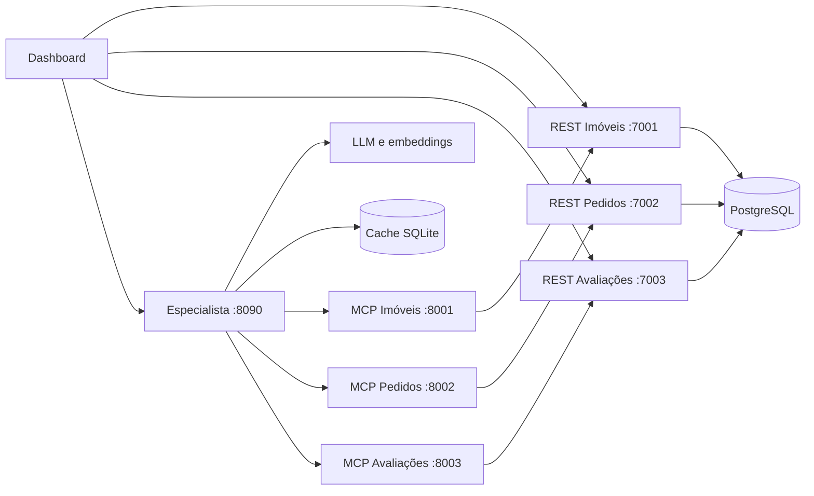

# Locação Residencial v2 — Sistema Especialista com Julgador

Sistema de locação residencial com **Arquitetura Orientada a Serviços (SOA)** para uma imobiliária.
O assistente recomenda imóveis de acordo com orçamento, localização e quartos, consultando os dados via MCP. A v2 mantém os três serviços REST e acrescenta chat web, cache semântico e avaliação LLM-as-a-Judge. O domínio e os limites de atuação estão em `mcp/conhecimento.md`.

## Iniciar

Instale/abra o Docker Desktop com suporte a contêineres Linux. No PowerShell, dentro desta pasta:

```powershell
if (!(Test-Path .env)) { Copy-Item .env.exemplo .env }
docker compose up -d --build
docker compose ps
```

Abra **http://localhost:8088** e use o painel **Assistente de locação**. A API do chat roda em `localhost:8090` e aceita apenas as origens locais do painel. A chave fica no contêiner. O painel de cadastro e consulta continua funcionando sem chave de IA.
A primeira inicialização baixa as imagens e cria o banco com doze imóveis, doze pedidos e três avaliações.
Não precisa instalar Python no Windows nem criar uma rede Docker manualmente.

Para o chat, edite o `.env` existente. Escolha o provedor, preencha a chave correspondente
e informe o modelo desejado. Mantenha a chave privada e não compartilhe o arquivo `.env`.

| PROVEDOR_IA | Chave no .env | Modelo padrão quando MODELO_IA está vazio |
|---|---|---|
| `openai` | `OPENAI_API_KEY` | `gpt-4.1-mini` |
| `google` | `GOOGLE_API_KEY` | `gemini-flash-latest` |
| `claude` | `ANTHROPIC_API_KEY` | `claude-sonnet-4-6` |
| `outro` | `CHAVE_API_IA` | Preencher `MODELO_IA` e `URL_IA` |

Exemplo para OpenAI:

```dotenv
PROVEDOR_IA=openai
MODELO_IA=gpt-4.1-mini
OPENAI_API_KEY=coloque_sua_chave_aqui
```

Para trocar, altere `PROVEDOR_IA` e deixe `MODELO_IA` vazio para usar o padrão,
ou informe um modelo disponível na conta. O modelo precisa aceitar ferramentas (function calling).
Para outro provedor, `URL_IA` é a URL base da API compatível com OpenAI Chat Completions,
por exemplo `https://servidor.example/v1`; não é a página do chat no navegador.
APIs com outros formatos precisam de adaptação no código.

O mesmo SDK usa os endpoints oficiais de cada provedor. A compatibilidade do Claude é
voltada a testes e comparação; recursos exclusivos de cada provedor não fazem parte deste chat.
Assinaturas dos aplicativos de chat não substituem a chave e a cota da API.

O chat web usa o serviço `especialista`. Após alterar o `.env`, execute `docker compose up -d especialista` para aplicar a configuração. O terminal permanece disponível:

```powershell
docker compose build chat
docker compose run --rm chat
```

Perguntas para experimentar:

- Quero um apartamento de dois quartos no Centro até R$ 1.300. Qual você recomenda?
- E se o meu limite subir para R$ 1.500? Compare as opções.
- Quais imóveis estão disponíveis? Informe bairro, quartos e valor mensal.
- Qual é a situação do pedido 1?
- Quais pedidos estão pendentes?
- Quais são as avaliações do imóvel 3?
- Mostre a quantidade de avaliações e a nota média por imóvel.

Digite `sair` para encerrar. O chat mantém o histórico durante a execução.
O chat apresenta ao modelo escolhido as ferramentas descobertas nos MCPs. A IA escolhe as consultas;
o chat chama o MCP correspondente e devolve o resultado para a IA formular a resposta.
As nove ferramentas têm nomes diferentes e só consultam dados.

## Modelos locais e juiz independente

Chat e julgador podem usar provedores e modelos diferentes. `PROVEDOR_JUIZ` aceita `openai`, `google`, `claude` ou `outro`. Quando vazio, herda o endpoint e a chave do chat; `MODELO_JUIZ` pode sobrescrever apenas o modelo. Com provedor explícito, o modelo vazio usa o padrão desse provedor. `CHAVE_API_JUIZ` permite uma credencial própria; quando omitida para um provedor conhecido, usa a chave correspondente (`GOOGLE_API_KEY`, por exemplo).

Exemplo para manter o chat atual e usar Qwen no julgador, servido pelo Ollama instalado no computador:

```dotenv
PROVEDOR_JUIZ=outro
MODELO_JUIZ=qwen3:8b
URL_JUIZ=http://host.docker.internal:11434/v1
CHAVE_API_JUIZ=ollama
```

Para usar Qwen também no chat:

```dotenv
PROVEDOR_IA=outro
MODELO_IA=qwen3:8b
URL_IA=http://host.docker.internal:11434/v1
CHAVE_API_IA=ollama
MODELO_EMBEDDING=
```

O servidor local e o modelo precisam estar instalados e acessíveis pelo contêiner. `host.docker.internal` acessa o computador pelo Docker Desktop; fora do Docker, use `localhost`. O valor `ollama` é fictício, exigido pelo cliente e ignorado pelo Ollama local. HTTP é aceito apenas para os endereços locais previstos; outros servidores precisam de HTTPS. O chat exige suporte a ferramentas, e o julgador exige saída JSON estruturada. A compatibilidade depende do modelo e do servidor. Os limites atuais são 25 segundos por chamada e 90 por turno; o carregamento de um modelo local pode excedê-los.

Ao trocar o provedor do chat, deixe inicialmente `MODELO_EMBEDDING` vazio ou configure um modelo de embeddings disponível no novo endpoint; não reutilize o identificador do Google no Ollama. A troca apenas do juiz não altera os embeddings. Aplique mudanças do chat com `docker compose up -d especialista`; cada execução de `docker compose run --rm chat ...` já lê a configuração atual. O projeto não baixa modelos automaticamente.

## Cache semântico

Configure `MODELO_EMBEDDING` no `.env` com um modelo de embeddings disponível no endpoint compatível do provedor escolhido. Sem essa configuração, o chat funciona sem cache. `CACHE_LIMIAR` tem valor inicial `0.85` (ajuste com dados do seu modelo) e `CACHE_TTL` é expresso em segundos, com padrão de um dia. O volume `cache-especialista` mantém o SQLite entre reinícios. Erros no cache ou embeddings não impedem a resposta pelo LLM.

O cache compartilhado usa embeddings e similaridade cosseno para as formulações públicas revisadas em `mcp/cache_semantico.py` e também adiciona dinamicamente perguntas gerais sobre o serviço (como dúvidas de escopo/venda) quando a resposta do assistente não aciona ferramentas MCP. Consultas sobre preços, disponibilidade, pedidos, avaliações e recomendações personalizadas passam sempre pelo fluxo normal com MCP.

Quando ocorre `cache = hit` no chat web, a interface exibe que a resposta foi **recuperada do cache semântico** (com o percentual de similaridade) e **dispensa a chamada ao julgador**, evitando gasto e latência desnecessários para uma resposta já avaliada.

Para demonstrar, pergunte **O que significa um pedido pendente?** (ou **Tem apartamentos para venda?**). Em seguida, repita a pergunta ou faça uma paráfrase (**O que quer dizer pedido pendente?**). Observe `cache=miss` na primeira e `cache=hit` na segunda tanto no painel quanto em `docker compose logs especialista`. Para limpar somente o cache, use `docker compose run --rm chat python cache_semantico.py limpar`.

## Avaliação com o julgador

O julgador faz uma chamada independente de avaliação e usa o mesmo núcleo do chat, com o cache desativado na bateria de casos. Configure o modelo e, opcionalmente, o provedor conforme a seção anterior; sem configuração própria, usa o modelo do assistente. Os casos tomam como referência os dados fictícios iniciais do SQL. Use um ambiente de demonstração com esses dados e revise o relatório antes de compartilhá-lo.

Acesse [Notas do julgador](http://localhost:8088/julgador.html) pelo menu do painel. A página lê os relatórios JSON já salvos em `resultados/`: permite escolher a rodada, filtrar resultados e consultar as cinco notas, justificativas, verificações automáticas e evidências de cada caso. Atualizar a página não executa IA. Parecer inválido aparece como **sem notas válidas**, nunca como zero. As contagens preservam o resultado registrado e não representam, sozinhas, a acurácia do assistente.

A avaliação funciona de duas formas:

1. **Conversas do chat web (`resultados/chat-web.json`):** cada resposta concluída em `POST /chat` é avaliada pelo julgador com base nas evidências MCP consultadas e nas regras de `mcp/conhecimento.md`. O resultado é gravado e atualizado por sessão em `resultados/chat-web.json` pelo serviço `especialista`, ficando disponível imediatamente na aba **Notas do julgador** (`http://localhost:8088/julgador.html`). Falhas no julgamento ficam registradas como `sem_notas` sem interromper a resposta ao usuário.
2. **Bateria reproduzível pelo terminal (`mcp/casos_julgador.json`):** o serviço `especialista` expõe `GET /julgador/relatorios` e `GET /julgador/relatorios/<nome>`. Apenas relatórios v2 válidos na raiz da pasta são listados; arquivos de medição do cache não entram na página. O contêiner `chat` também grava relatórios pelo comando abaixo.

```powershell
docker compose run --rm chat python julgador.py --caso orcamento_quartos --saida resultados/um-caso.json
docker compose run --rm chat python julgador.py --todos --saida resultados/julgador.json
docker compose run --rm chat python julgador.py --medir-cache --saida resultados/cache.json
```

Esses comandos fazem chamadas reais à API. Comece por um caso; o lote tem 13 casos e 14 turnos de inferência, além de até 13 julgamentos e consultas de ferramentas. O comando de cache usa SQLite temporário e mede duas paráfrases sem interferir no cache do painel. Os relatórios ficam em `resultados/` (ignorado no Git), com evidências, latências, verificações objetivas e notas. Saída `0` indica aprovação; `1` indica caso reprovado, avaliação inválida ou cache sem o hit esperado. Revise amostras manualmente: as notas do juiz podem variar e não substituem a inspeção das respostas.

O juiz solicita saída JSON estruturada. O lote espera 20 segundos entre casos por padrão; use `--intervalo 25` ou aumente conforme a cota do provedor. Essa pausa não garante todas as cotas: cada caso pode chamar o modelo mais de uma vez, e o painel compartilha a mesma conta. Erros continuam registrados como falhas, sem aprovação automática nem repetição oculta.

## Pastas

```text
locacao-residencial/
├── docker-compose.yml          # Inicia a solução inteira
├── .env.exemplo                # Configuração sem uma chave real
├── requirements.txt            # Dependências para execução local opcional
├── README.md                   # Instalação, regras e rotas
├── dashboard/
│   ├── index.html
│   ├── estilo.css
│   ├── chat.js
│   ├── julgador.html, julgador.css, julgador.js
│   └── painel.js
├── servicos/
│   ├── Dockerfile
│   ├── requirements.txt
│   ├── banco.py                # Conexão e tratamento de erros comuns
│   ├── locacao.sql             # Tabelas, views, restrições e dados fictícios
│   ├── testar.py               # Teste em um banco temporário separado
│   ├── imoveis/servico.py
│   ├── pedidos/servico.py
│   └── avaliacoes/servico.py
└── mcp/
    ├── Dockerfile
    ├── requirements.txt
    ├── acesso.py               # Acesso HTTP com limite de tempo
    ├── chat_ai.py
    ├── chat_web.py, especialista.py, conhecimento.md
    ├── cache_semantico.py
    ├── julgador.py, casos_julgador.json
    ├── relatorios_julgador.py, testar_relatorios.py
    ├── testar_v2.py
    ├── testar_mcp.py
    ├── testar_chat.py          # IA simulada, sem chamada externa
    ├── imoveis/ferramentas.py
    ├── pedidos/ferramentas.py
    └── avaliacoes/ferramentas.py
```

## Arquitetura e responsabilidades



Cada serviço REST e cada serviço MCP executa em seu próprio contêiner. A dashboard também tem um contêiner.
O Compose cria a rede automaticamente; os nomes `imoveis`, `pedidos` e `avaliacoes` são os endereços internos.
Os acessos pelo navegador usam `localhost` e as portas publicadas.

Os três serviços utilizam um banco PostgreSQL compartilhado.
Cada serviço tem seu processo, suas rotas e uma responsabilidade: imóveis e disponibilidade;
andamento dos pedidos; registro e consulta das avaliações. Nenhum serviço importa o código dos outros dois.
O banco é uma dependência comum: sua queda afeta os três serviços; parar apenas um serviço REST não para os demais.

## Regras de negócio

- Um pedido novo sempre começa **pendente**, inclusive quando o imóvel está ocupado: registra apenas interesse.
- `pendente → aprovado`, `pendente → recusado` ou `pendente → cancelado`.
- `aprovado → concluido` ou `aprovado → cancelado`.
- Aprovação reserva; conclusão efetiva a locação; cancelar uma aprovação libera o imóvel.
- Pedidos recusados, cancelados ou concluídos não mudam mais. Repetir a mesma situação é permitido e não duplica nada.
- Um índice único parcial no PostgreSQL impede dois pedidos aprovados/concluídos para o mesmo imóvel,
  mesmo se chegarem ao mesmo tempo. O conflito retorna HTTP 409.
- A view `vw_imoveis` calcula `disponivel`, `reservado` ou `alugado` usando o pedido vigente.
  Assim, não é necessário atualizar a mesma informação em duas tabelas ou serviços.
- Uma avaliação exige pedido concluído, nota inteira de 1 a 5 e comentário de até 500 caracteres.
  A restrição `UNIQUE(pedido_id)` permite apenas uma avaliação por locação.
- Cliente e imóvel da avaliação são obtidos do pedido. A equipe registra a avaliação recebida do cliente.

O cliente é identificado pelo nome no pedido, sem cadastro separado.
Não há login; portanto, o sistema não verifica a identidade de quem opera o formulário.
As portas são publicadas somente no computador local. Esta versão é destinada à execução local.
Não inclui pagamentos, crédito, assinatura digital nem encerramento/devolução de uma locação vigente.
Como não há devolução neste escopo, um imóvel alugado permanece alugado.
O servidor embutido do Flask é usado na execução local; uma implantação pública exigiria servidor WSGI e autenticação.

## Rotas

Todas as respostas são JSON. Os identificadores numéricos aparecem na dashboard.
Cada serviço também tem `GET /`, com descrição e versão.

| Serviço | Método e rota | Finalidade | Ferramenta MCP |
|---|---|---|---|
| Imóveis, 7001 | `GET /imoveis` | Listar imóveis | `get_imoveis` |
| Imóveis, 7001 | `GET /imoveis/situacao/<situacao>` | Filtrar disponibilidade | `get_imoveis_por_situacao` |
| Imóveis, 7001 | `GET /imoveis/<id>` | Consultar um imóvel | `get_imovel_por_id` |
| Imóveis, 7001 | `POST /imoveis` | Cadastrar imóvel | — |
| Pedidos, 7002 | `GET /pedidos` | Listar pedidos | `get_pedidos` |
| Pedidos, 7002 | `GET /pedidos/situacao/<situacao>` | Filtrar pedidos | `get_pedidos_por_situacao` |
| Pedidos, 7002 | `GET /pedidos/<id>` | Consultar pedido | `get_pedido_por_id` |
| Pedidos, 7002 | `POST /pedidos` | Registrar interesse | — |
| Pedidos, 7002 | `PATCH /pedidos/<id>/situacao` | Alterar situação | — |
| Avaliações, 7003 | `GET /avaliacoes` | Listar avaliações | `get_avaliacoes` |
| Avaliações, 7003 | `GET /avaliacoes/imovel/<id>` | Consultar por imóvel | `get_avaliacoes_por_imovel` |
| Avaliações, 7003 | `GET /avaliacoes/resumo` | Quantidades e médias | `get_resumo_avaliacoes` |
| Avaliações, 7003 | `POST /avaliacoes` | Registrar avaliação | — |

Exemplos de corpos JSON, que também podem ser enviados pelos formulários da dashboard:

```json
{"descricao":"Casa com quintal","bairro":"Centro","tipo":"casa","quartos":2,"valor_mensal":1250}
```

```json
{"cliente":"Maria Silva","imovel_id":1}
```

```json
{"situacao":"aprovado"}
```

```json
{"pedido_id":1,"nota":5,"comentario":"Boa localização."}
```

O último exemplo só funciona depois que o pedido 1 estiver concluído e ainda não tiver avaliação.
Status: `200` consulta/alteração; `201` cadastro; `400` dados inválidos; `404` registro inexistente;
`409` conflito de regra; `413` corpo muito grande; `415` conteúdo sem JSON; `503` banco indisponível.

## Demonstrar independência e recuperação

Com a dashboard aberta:

```powershell
docker compose stop avaliacoes
```

Em até aproximadamente 11 segundos, apenas a seção de avaliações avisa que está indisponível.
Imóveis e pedidos continuam consultando e funcionando. Dados antigos da área com falha são removidos.
Depois:

```powershell
docker compose start avaliacoes
```

A seção volta na próxima consulta bem-sucedida, sem recarregar a página.
O JavaScript atualiza a cada cinco segundos, trata erros por área e limita cada requisição a seis segundos.
Também pode repetir a demonstração com `imoveis` ou `pedidos`.

## Testes

Com a solução iniciada, rode:

```powershell
docker compose run --rm imoveis python testar.py
docker compose run --rm chat python testar_mcp.py
docker compose run --rm chat python testar_chat.py
docker compose run --rm chat python testar_v2.py
docker compose run --rm --no-deps especialista python testar_relatorios.py
```

O primeiro teste cria um banco com nome aleatório e o remove ao terminar; não altera os dados do projeto.
Ele verifica as regras, inclusive aprovações concorrentes. Exige que o usuário do PostgreSQL possa criar bancos,
como o usuário inicial configurado pelo Compose.
O segundo consulta as nove ferramentas MCP reais. Não chama a IA e não exige uma chave.
O terceiro simula a IA e o MCP: verifica os três provedores conhecidos e um endpoint local compatível, configuração independente do juiz, envio de ferramentas, histórico,
argumentos inválidos e falhas de consulta. Não exige chave, serviços iniciados ou acesso à internet.
Esse teste não substitui a demonstração com uma chave real.
O quarto verifica paráfrases, persistência e expiração do cache, atualização de disponibilidade, sessões web e validação do julgador, com IA e dados MCP simulados.
O quinto verifica a API de relatórios com arquivos temporários: notas ausentes, resultados preservados, ordenação, arquivos inválidos, limites, CORS e bloqueio de caminhos externos. Não chama a IA nem altera os relatórios reais.
Não rode Python com a opção `-O`, que desativa os `assert` dos testes.

## Parar, retomar e consultar falhas

```powershell
docker compose logs --tail 50
docker compose down
docker compose up -d
```

`down` preserva o volume com os dados. O script SQL inicial só roda quando o volume é novo.
Se precisar **apagar os dados deste projeto** e voltar aos exemplos iniciais, use conscientemente:

```powershell
docker compose down -v
docker compose up -d
```

Se uma porta estiver ocupada, encerre o serviço que a utiliza ou ajuste o mapeamento no Docker Compose.
A dashboard utiliza a porta 8088.
Se o Docker não iniciar, confira se há espaço em disco e se o mecanismo Linux/WSL está disponível.
Se a IA falhar, confira chave, nome do modelo e cota da conta; os serviços REST e a dashboard não dependem dela.

Se `docker compose logs especialista` mostrar `APIConnectionError` e o ambiente fizer inspeção HTTPS, confira se a CA local está na cadeia confiável do contêiner. `docker-compose.tls.exemplo.yml` mostra um override opcional para `especialista` e `chat` (também usado pelo julgador). Use somente uma CA pública do ambiente que você confia, junto das CAs padrão. Guarde o bundle em `.venv/ca-runtime.pem` e a configuração ativa em `docker-compose.override.yml`, ambos locais. Esse ajuste deve manter a verificação TLS habilitada.

## Referências técnicas

- [SDK oficial do MCP, versão 1.30.0](https://github.com/modelcontextprotocol/python-sdk/tree/v1.30.0)
- [SDK oficial da OpenAI](https://github.com/openai/openai-python)
- [Google: interface compatível com OpenAI](https://ai.google.dev/gemini-api/docs/openai)
- [Claude: compatibilidade e limitações](https://platform.claude.com/docs/en/cli-sdks-libraries/libraries/openai-sdk)
- [Ollama: API compatível com OpenAI](https://docs.ollama.com/api/openai-compatibility)
- [Ollama: ferramentas com Qwen](https://docs.ollama.com/capabilities/tool-calling)
