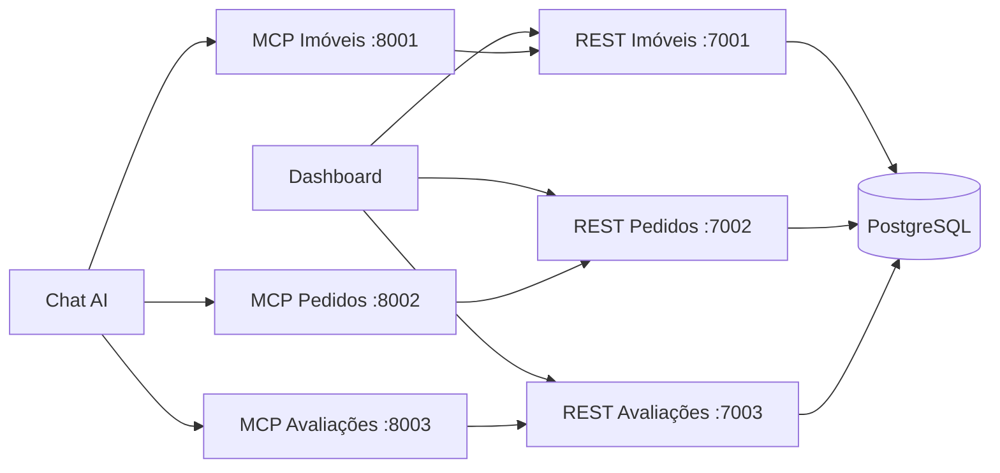

# Locação Residencial

Sistema de locação residencial com **Arquitetura Orientada a Serviços (SOA)** para uma imobiliária.
Três serviços REST em Python/Flask, três serviços MCP, dashboard e chat com OpenAI, Google ou Claude.
Funções e variáveis em português e consultas SQL diretas.
O domínio, os dados e as regras são de locação residencial.

## Iniciar

Instale/abra o Docker Desktop com suporte a contêineres Linux. No PowerShell, dentro desta pasta:

```powershell
if (!(Test-Path .env)) { Copy-Item .env.exemplo .env }
docker compose up -d --build
docker compose ps
```

Abra **http://localhost:8088**. Não abra o HTML diretamente: o endereço acima permite as consultas CORS.
A primeira inicialização baixa as imagens e cria o banco com seis imóveis, seis pedidos e uma avaliação.
Não precisa instalar Python no Windows nem criar uma rede Docker manualmente.

Para o chat, edite o `.env` existente. Escolha o provedor, preencha a chave correspondente
e informe o modelo desejado. Mantenha a chave privada e não compartilhe o arquivo `.env`.

| PROVEDOR_IA | Chave no .env | Modelo padrão quando MODELO_IA está vazio |
|---|---|---|
| `openai` | `OPENAI_API_KEY` | `gpt-4.1-mini` |
| `google` | `GOOGLE_API_KEY` | `gemini-flash-latest` |
| `claude` | `ANTHROPIC_API_KEY` | `claude-sonnet-4-6` |
| `outro` | `CHAVE_API_IA` | Preencher `MODELO_IA` e `URL_IA` |

Exemplo para OpenAI:

```dotenv
PROVEDOR_IA=openai
MODELO_IA=gpt-4.1-mini
OPENAI_API_KEY=coloque_sua_chave_aqui
```

Para trocar, altere `PROVEDOR_IA` e deixe `MODELO_IA` vazio para usar o padrão,
ou informe um modelo disponível na conta. O modelo precisa aceitar ferramentas (function calling).
Para outro provedor, `URL_IA` é a URL base da API compatível com OpenAI Chat Completions,
por exemplo `https://servidor.example/v1`; não é a página do chat no navegador.
APIs com outros formatos precisam de adaptação no código.

O mesmo SDK usa os endpoints oficiais de cada provedor. A compatibilidade do Claude é
voltada a testes e comparação; recursos exclusivos de cada provedor não fazem parte deste chat.
Assinaturas dos aplicativos de chat não substituem a chave e a cota da API.

Construa a imagem do chat e inicie uma sessão. Ao trocar apenas a configuração no `.env`, basta iniciar outro chat:

```powershell
docker compose build chat
docker compose run --rm chat
```

Perguntas para experimentar:

- Quais imóveis estão disponíveis? Informe bairro, quartos e valor mensal.
- Qual é a situação do pedido 1?
- Quais pedidos estão pendentes?
- Quais são as avaliações do imóvel 3?
- Mostre a quantidade de avaliações e a nota média por imóvel.

Digite `sair` para encerrar. O chat mantém o histórico durante a execução.
O chat apresenta ao modelo escolhido as ferramentas descobertas nos MCPs. A IA escolhe as consultas;
o chat chama o MCP correspondente e devolve o resultado para a IA formular a resposta.
As nove ferramentas têm nomes diferentes e só consultam dados.

## Pastas

```text
locacao-residencial/
├── docker-compose.yml          # Inicia a solução inteira
├── .env.exemplo                # Configuração sem uma chave real
├── requirements.txt            # Dependências para execução local opcional
├── README.md                   # Instalação, regras e rotas
├── dashboard/
│   ├── index.html
│   ├── estilo.css
│   └── painel.js
├── servicos/
│   ├── Dockerfile
│   ├── requirements.txt
│   ├── banco.py                # Conexão e tratamento de erros comuns
│   ├── locacao.sql             # Tabelas, views, restrições e dados fictícios
│   ├── testar.py               # Teste em um banco temporário separado
│   ├── imoveis/servico.py
│   ├── pedidos/servico.py
│   └── avaliacoes/servico.py
└── mcp/
    ├── Dockerfile
    ├── requirements.txt
    ├── acesso.py               # Acesso HTTP com limite de tempo
    ├── chat_ai.py
    ├── testar_mcp.py
    ├── testar_chat.py          # IA simulada, sem chamada externa
    ├── imoveis/ferramentas.py
    ├── pedidos/ferramentas.py
    └── avaliacoes/ferramentas.py
```

## Arquitetura e responsabilidades



Cada serviço REST e cada serviço MCP executa em seu próprio contêiner. A dashboard também tem um contêiner.
O Compose cria a rede automaticamente; os nomes `imoveis`, `pedidos` e `avaliacoes` são os endereços internos.
Os acessos pelo navegador usam `localhost` e as portas publicadas.

Os três serviços utilizam um banco PostgreSQL compartilhado.
Cada serviço tem seu processo, suas rotas e uma responsabilidade: imóveis e disponibilidade;
andamento dos pedidos; registro e consulta das avaliações. Nenhum serviço importa o código dos outros dois.
O banco é uma dependência comum: sua queda afeta os três serviços; parar apenas um serviço REST não para os demais.

## Regras de negócio

- Um pedido novo sempre começa **pendente**, inclusive quando o imóvel está ocupado: registra apenas interesse.
- `pendente → aprovado`, `pendente → recusado` ou `pendente → cancelado`.
- `aprovado → concluido` ou `aprovado → cancelado`.
- Aprovação reserva; conclusão efetiva a locação; cancelar uma aprovação libera o imóvel.
- Pedidos recusados, cancelados ou concluídos não mudam mais. Repetir a mesma situação é permitido e não duplica nada.
- Um índice único parcial no PostgreSQL impede dois pedidos aprovados/concluídos para o mesmo imóvel,
  mesmo se chegarem ao mesmo tempo. O conflito retorna HTTP 409.
- A view `vw_imoveis` calcula `disponivel`, `reservado` ou `alugado` usando o pedido vigente.
  Assim, não é necessário atualizar a mesma informação em duas tabelas ou serviços.
- Uma avaliação exige pedido concluído, nota inteira de 1 a 5 e comentário de até 500 caracteres.
  A restrição `UNIQUE(pedido_id)` permite apenas uma avaliação por locação.
- Cliente e imóvel da avaliação são obtidos do pedido. A equipe registra a avaliação recebida do cliente.

O cliente é identificado pelo nome no pedido, sem cadastro separado.
Não há login; portanto, o sistema não verifica a identidade de quem opera o formulário.
As portas são publicadas somente no computador local. Esta versão é destinada à execução local.
Não inclui pagamentos, crédito, assinatura digital nem encerramento/devolução de uma locação vigente.
Como não há devolução neste escopo, um imóvel alugado permanece alugado.
O servidor embutido do Flask é usado na execução local; uma implantação pública exigiria servidor WSGI e autenticação.

## Rotas

Todas as respostas são JSON. Os identificadores numéricos aparecem na dashboard.
Cada serviço também tem `GET /`, com descrição e versão.

| Serviço | Método e rota | Finalidade | Ferramenta MCP |
|---|---|---|---|
| Imóveis, 7001 | `GET /imoveis` | Listar imóveis | `get_imoveis` |
| Imóveis, 7001 | `GET /imoveis/situacao/<situacao>` | Filtrar disponibilidade | `get_imoveis_por_situacao` |
| Imóveis, 7001 | `GET /imoveis/<id>` | Consultar um imóvel | `get_imovel_por_id` |
| Imóveis, 7001 | `POST /imoveis` | Cadastrar imóvel | — |
| Pedidos, 7002 | `GET /pedidos` | Listar pedidos | `get_pedidos` |
| Pedidos, 7002 | `GET /pedidos/situacao/<situacao>` | Filtrar pedidos | `get_pedidos_por_situacao` |
| Pedidos, 7002 | `GET /pedidos/<id>` | Consultar pedido | `get_pedido_por_id` |
| Pedidos, 7002 | `POST /pedidos` | Registrar interesse | — |
| Pedidos, 7002 | `PATCH /pedidos/<id>/situacao` | Alterar situação | — |
| Avaliações, 7003 | `GET /avaliacoes` | Listar avaliações | `get_avaliacoes` |
| Avaliações, 7003 | `GET /avaliacoes/imovel/<id>` | Consultar por imóvel | `get_avaliacoes_por_imovel` |
| Avaliações, 7003 | `GET /avaliacoes/resumo` | Quantidades e médias | `get_resumo_avaliacoes` |
| Avaliações, 7003 | `POST /avaliacoes` | Registrar avaliação | — |

Exemplos de corpos JSON, que também podem ser enviados pelos formulários da dashboard:

```json
{"descricao":"Casa com quintal","bairro":"Centro","tipo":"casa","quartos":2,"valor_mensal":1250}
```

```json
{"cliente":"Maria Silva","imovel_id":1}
```

```json
{"situacao":"aprovado"}
```

```json
{"pedido_id":1,"nota":5,"comentario":"Boa localização."}
```

O último exemplo só funciona depois que o pedido 1 estiver concluído e ainda não tiver avaliação.
Status: `200` consulta/alteração; `201` cadastro; `400` dados inválidos; `404` registro inexistente;
`409` conflito de regra; `413` corpo muito grande; `415` conteúdo sem JSON; `503` banco indisponível.

## Demonstrar independência e recuperação

Com a dashboard aberta:

```powershell
docker compose stop avaliacoes
```

Em até aproximadamente 11 segundos, apenas a seção de avaliações avisa que está indisponível.
Imóveis e pedidos continuam consultando e funcionando. Dados antigos da área com falha são removidos.
Depois:

```powershell
docker compose start avaliacoes
```

A seção volta na próxima consulta bem-sucedida, sem recarregar a página.
O JavaScript atualiza a cada cinco segundos, trata erros por área e limita cada requisição a seis segundos.
Também pode repetir a demonstração com `imoveis` ou `pedidos`.

## Testes

Com a solução iniciada, rode:

```powershell
docker compose run --rm imoveis python testar.py
docker compose run --rm chat python testar_mcp.py
docker compose run --rm chat python testar_chat.py
```

O primeiro teste cria um banco com nome aleatório e o remove ao terminar; não altera os dados do projeto.
Ele verifica as regras, inclusive aprovações concorrentes. Exige que o usuário do PostgreSQL possa criar bancos,
como o usuário inicial configurado pelo Compose.
O segundo consulta as nove ferramentas MCP reais. Não chama a IA e não exige uma chave.
O terceiro simula a IA e o MCP: verifica os três provedores, envio de ferramentas, histórico,
argumentos inválidos e falhas de consulta. Não exige chave, serviços iniciados ou acesso à internet.
Esse teste não substitui a demonstração com uma chave real.
Não rode Python com a opção `-O`, que desativa os `assert` dos testes.

## Parar, retomar e consultar falhas

```powershell
docker compose logs --tail 50
docker compose down
docker compose up -d
```

`down` preserva o volume com os dados. O script SQL inicial só roda quando o volume é novo.
Se precisar **apagar os dados deste projeto** e voltar aos exemplos iniciais, use conscientemente:

```powershell
docker compose down -v
docker compose up -d
```

Se uma porta estiver ocupada, encerre o serviço que a utiliza ou ajuste o mapeamento no Docker Compose.
A dashboard utiliza a porta 8088.
Se o Docker não iniciar, confira se há espaço em disco e se o mecanismo Linux/WSL está disponível.
Se a IA falhar, confira chave, nome do modelo e cota da conta; os serviços REST e a dashboard não dependem dela.

## Referências técnicas

- [SDK oficial do MCP, versão 1.30.0](https://github.com/modelcontextprotocol/python-sdk/tree/v1.30.0)
- [SDK oficial da OpenAI](https://github.com/openai/openai-python)
- [Google: interface compatível com OpenAI](https://ai.google.dev/gemini-api/docs/openai)
- [Claude: compatibilidade e limitações](https://platform.claude.com/docs/en/cli-sdks-libraries/libraries/openai-sdk)
